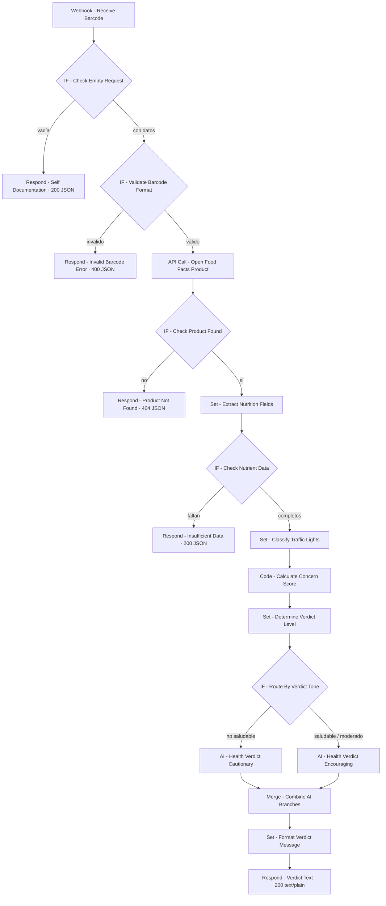

# 🥫 SnackCheck: ¿Es saludable este snack?

> Envía un código de barras y recibe, en lenguaje claro y amigable, si el producto es una buena elección para el día a día o mejor un capricho ocasional.

Automatización en **n8n** que consulta datos nutricionales reales en **Open Food Facts**, aplica las reglas de semáforo y de Nutri-Score del fundador de SnackCheck y usa **IA (Groq)** para escribir un veredicto con un tono que se adapta al resultado.

---

## 1. Propósito

SnackCheck es una app de consumo: el usuario escanea el código de barras de un producto envasado y recibe un veredicto de salud al instante. Esta automatización es el **motor** que hay detrás:

- Usa **datos reales**: no se inventa ninguna cifra nutricional.
- Aplica una **hoja de reglas explícita** (semáforo y Nutri-Score) para decidir el veredicto.
- Devuelve un mensaje **humano**, alentador cuando el producto está bien y honesto con delicadeza cuando no lo está.
- **Nunca se cae**: toda entrada incorrecta o todo caso sin datos recibe una respuesta clara y útil.

---

## 2. Cómo funciona



### Paso a paso

1. **Recepción**: el webhook recibe un `POST` con `{ "barcode": "..." }`.
2. **Autodocumentación**: si el cuerpo llega vacío, el servicio responde explicando qué hace y cómo usarlo.
3. **Validación**: el `barcode` tiene que existir y contener solo dígitos.
4. **Datos**: se consulta Open Food Facts. Si el producto no existe (404 con `status: 0`), se devuelve una respuesta propia de "no encontrado".
5. **Extracción**: los campos se aplanan en variables simples. La energía se lee con notación de corchetes: `$json.nutriments['energy-kcal_100g']`.
6. **Comprobación de datos**: si faltan el azúcar, la sal o la grasa, **no se clasifica** el producto.
7. **Clasificación por semáforo**, por cada 100 g:

   | Nutriente | Bajo | Medio | Alto |
   |---|---|---|---|
   | Azúcar | < 5 g | 5 – 22,5 g | > 22,5 g |
   | Sal | — | — | > 1,5 g |
   | Grasa | — | — | > 17,5 g |

8. **Puntuación de preocupación**: el número de nutrientes en `alto` (de 0 a 3), calculado en el nodo Code.
9. **Veredicto**: se calculan dos lecturas independientes y **gana la peor**.

   | Lectura de semáforo (nº de altos) | Lectura de Nutri-Score |
   |---|---|
   | 0 → saludable | a / b → saludable |
   | 1 → moderado | c → moderado |
   | 2–3 → no saludable | d / e → no saludable |

   Si el Nutri-Score es `unknown` o falta, se usa **solo la lectura de semáforo**.

10. **IA con tono condicional**: un IF envía el caso al prompt **cauteloso** (`no saludable`) o al **alentador** (`saludable` / `moderado`). Las dos ramas se unen en un Merge en modo Append.
11. **Formato**: un titular con emoji, los nutrientes con marcadores 🔴/🟢 y el párrafo de la IA, devuelto como texto plano.

> **Por qué gana la peor lectura:** una bebida azucarada como la Coca-Cola no llega a `alto` en ningún nutriente por cada 100 ml (0 altos, es decir, "saludable" según el semáforo), pero su Nutri-Score es `e`. El veredicto final es **no saludable**.

---

## 3. Configuración

### Requisitos

- Una instancia de n8n (Cloud o autoalojada).
- **Credencial de Groq**: es la única cuenta del proyecto.
- Open Food Facts es **gratuita, abierta y no necesita clave ni registro**.

### Instalación

1. Importa el workflow en n8n.
2. Asigna tu credencial de Groq a los subnodos **Groq Chat Model** de los dos nodos de IA.
3. En `API Call - Open Food Facts Product`, cambia el email del header `User-Agent` por el tuyo. Open Food Facts pide identificarse así.
4. Activa el workflow y usa la **Production URL** del webhook.

### Nodos usados

Webhook · Respond to Webhook · HTTP Request (GET) · IF · Merge (Append) · Set / Edit Fields · Code (un ítem) · Basic LLM Chain + Groq Chat Model

---

## 4. Uso

```
POST https://<tu-instancia-n8n>/webhook/nutrition-check
Content-Type: application/json
```

### Entrada

| Campo | Tipo | Requerido | Regla |
|---|---|---|---|
| `barcode` | string | ✅ | Solo dígitos (EAN/UPC). También se acepta como número |

### Ejemplo de solicitud

```bash
curl -X POST "https://<tu-instancia-n8n>/webhook/nutrition-check" \
  -H "Content-Type: application/json" \
  -d '{"barcode": "3017620422003"}'
```

**PowerShell:**
```powershell
$json = '{"barcode":"3017620422003"}'
Invoke-RestMethod -Uri "https://<tu-instancia-n8n>/webhook/nutrition-check" -Method Post -ContentType "application/json; charset=utf-8" -Body ([System.Text.Encoding]::UTF8.GetBytes($json))
```

### Ejemplo de respuesta (`200 · text/plain`)

```
🛑 Mejor como capricho ocasional
Nutella · Nutella, Ferrero

🔴 Azúcar   52.13 g
🟢 Sal      0.107 g
🔴 Grasa    30.9 g
⚪ Energía  539 kcal
Nutri-Score: E · Preocupación: 2/3

<Párrafo generado por la IA con tono cauteloso, mencionando el producto y sus cifras reales.>
```

### Titulares según el veredicto

| Nivel | Titular | Tono de la IA |
|---|---|---|
| `saludable` | ✅ Buena elección para el día a día | Alentador |
| `moderado` | 🟡 Bien, con moderación | Alentador, con un aviso suave |
| `no saludable` | 🛑 Mejor como capricho ocasional | Cauteloso con delicadeza |

### Códigos de prueba

| Producto | Código | Resultado esperado |
|---|---|---|
| Nutella | `3017620422003` | no saludable (semáforo y Nutri-Score E) |
| Coca-Cola | `5449000000996` | no saludable (gana el Nutri-Score E) |
| Producto con Nutri-Score A | `<código>` | saludable (tono alentador) |

---

## 5. Manejo de errores

Todas las respuestas que no son el veredicto se devuelven en **JSON** con `Content-Type: application/json; charset=utf-8`.

| Situación | Código | Respuesta |
|---|---|---|
| Cuerpo vacío `{}` | **200** | Autodocumentación: descripción del servicio, campo requerido y ejemplo |
| `barcode` ausente o no numérico | **400** | `INVALID_BARCODE`, con el valor recibido y un ejemplo válido |
| Producto no encontrado en Open Food Facts | **404** | `PRODUCT_NOT_FOUND`, con el código consultado y un ejemplo válido |
| Producto encontrado pero sin azúcar, sal o grasa | **200** | `INSUFFICIENT_DATA`. No se clasifica |
| Nutri-Score `unknown` o ausente | **200** | Veredicto calculado solo con el semáforo |

**Ejemplo de error 400:**
```json
{
  "error": "INVALID_BARCODE",
  "mensaje": "El campo 'barcode' es obligatorio y solo puede contener números.",
  "recibido": "abc123",
  "ejemplo_solicitud": { "barcode": "3017620422003" }
}
```

**Ejemplo de error 404:**
```json
{
  "error": "PRODUCT_NOT_FOUND",
  "mensaje": "No encontramos ningún producto con ese código en Open Food Facts. Revisa que el número esté completo o prueba con otro producto.",
  "barcode": "0000000000000",
  "ejemplo_solicitud": { "barcode": "3017620422003" }
}
```

**Decisiones de robustez:**
- El nodo HTTP tiene activado **Never Error**, así que el 404 de la API se lee como una respuesta normal y no rompe el flujo.
- Un producto **sin datos nunca sale como "saludable"**: los campos vacíos se quedan en `null` (no en `0`) y el IF de datos corta el flujo antes de clasificar.

---

## 6. Limitaciones

- **Datos colaborativos**: Open Food Facts lo mantiene una comunidad, así que algunos productos tienen datos incompletos o desactualizados.
- **Valores por 100 g o 100 ml**: los umbrales no tienen en cuenta el tamaño real de la ración.
- **Solo tres nutrientes** en el semáforo: no se valoran la fibra, las proteínas, los aditivos ni el grado de procesamiento (NOVA).
- **Un producto por solicitud**: no hay consultas por lotes.
- **Solo en español**: el veredicto no está disponible en otros idiomas.
- **Dependencia de Groq**: si la IA falla o supera los límites de uso, no se genera el párrafo.
- **No es consejo médico**: es una orientación general basada en reglas de salud pública.

### Mejoras futuras

- Respuesta de respaldo sin IA si Groq falla, con un texto predefinido por nivel.
- Mostrar la puntuación de preocupación en la app como indicador visual.
- Sugerir alternativas más saludables de la misma categoría.
- Soporte multidioma, con el campo `idioma` en la entrada.
- Caché de productos consultados para reducir la latencia.

---

**Autor:** Sergio Sanz Lomas · Proyecto final del microsyllabus de automatización con n8n + IA · Ver [CHANGELOG.md](CHANGELOG.md) y [TEST_LOG.md](TEST_LOG.md)
